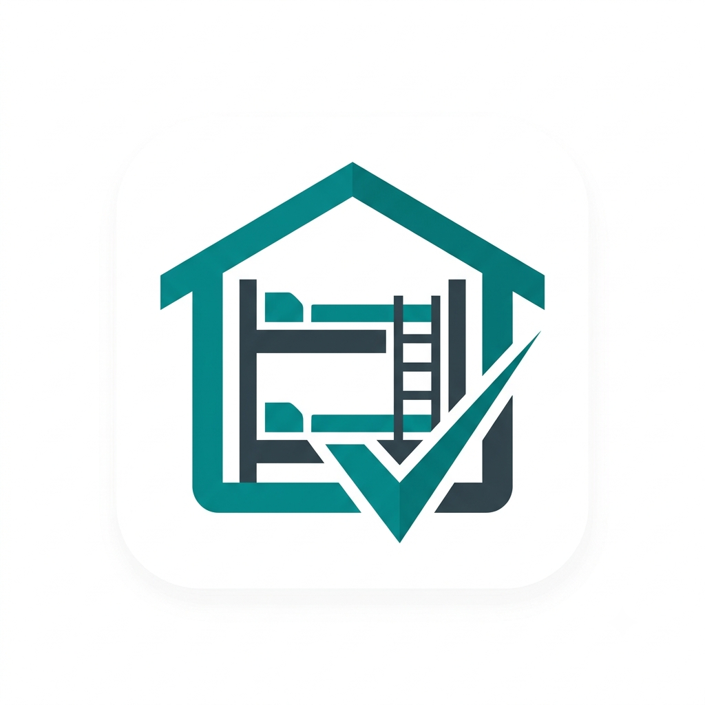

  

<h1 align="center">HostelDesk</h1>

  A local-first desktop app for hostel managers — rooms, residents, payments, and PDF receipts.

  
  
  

HostelDesk is built with a Rust ([Tauri](https://tauri.app)) backend and a React + TypeScript frontend. Everything runs locally — data lives in a SQLite database on the machine, and receipts are generated as offline PDFs — no server, no internet connection required.

## Install

Download an installer for your platform from [Releases](https://github.com/abenable/hosteldesk/releases).

## Documentation

- [Features](docs/FEATURES.md)
- [Install](docs/INSTALL.md)
- [Development guide](docs/DEVELOPMENT.md)
- [Licensing](docs/LICENSING.md)
- [Releasing](docs/RELEASING.md)

## License

Proprietary — see [`LICENSE`](LICENSE) and [`EULA.md`](EULA.md). Contact ableabenaitwe@gmail.com for licensing, purchasing, or support questions.
